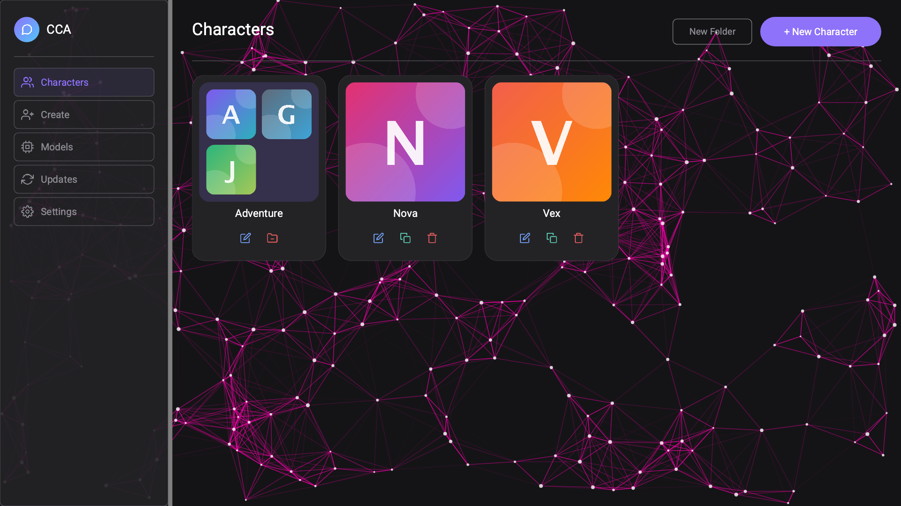

# CCA

CCA is a desktop app for chatting with AI characters. It runs models locally through
[llama.cpp](https://github.com/ggml-org/llama.cpp), or connects to a server or cloud endpoint you
choose. It is a port of my JavaFX app *character-chat-app* to [RenGL](https://github.com/piitex/RenGL),
my own UI engine.



More [screenshots](images/) are in the `images` folder.

## Download

Get the installer for your system from the [latest release](https://github.com/piitex/cca/releases/latest).

| System | File |
|---|---|
| Windows (x64) | `cca-<version>-windows-x64-setup.exe` |
| Linux (x64, Debian/Ubuntu) | `cca-<version>-linux-x64.deb` |
| Linux (x64, Fedora/RHEL) | `cca-<version>-linux-x64.rpm` |
| Linux (arm64) | `cca-<version>-linux-arm64.deb` / `.rpm` |
| macOS (Apple silicon) | `cca-<version>-macos-arm64.tar.gz` |
| macOS (Intel) | `cca-<version>-macos-x64.tar.gz` |

Each release lists SHA-256 checksums so you can check your download.

**The installers are not code-signed.** Windows SmartScreen may warn you the first time
("Windows protected your PC": choose *More info*, then *Run anyway*). On macOS, Gatekeeper blocks the
app until you allow it in *System Settings > Privacy & Security*, or run
`xattr -dr com.apple.quarantine cca.app` after extracting.

**Platform status:** Windows is the best tested. Linux and macOS builds are produced from the same code
but have had little testing. Please report problems you run into.

## Features

* Character cards: create, import and export (SillyTavern- and BackyardAI-style PNG cards)
* Users (personas), lorebooks, chat history and folders
* Run a model on your own machine: CCA downloads the right llama.cpp build and models from Hugging Face
* Or use an OpenAI-compatible server on your network or in the cloud
* Hardware probe that suggests settings for your GPU and memory
* App password: character, user and chat data and your keys are encrypted on disk
* Custom themes, animated backgrounds, spell checker
* Update or switch the llama.cpp backend from inside the app

## Privacy

CCA has no telemetry and no account. It only talks to the network when you ask it to:

* **Hugging Face**, to browse and download models
* **GitHub**, to find and download llama.cpp releases (CCA itself does not check for updates)
* **The server or cloud endpoint you configure**, to generate replies. Your messages go there, so
  choose one you trust.

Your data stays in CCA's data folder on your computer. Keys and tokens are stored encrypted with the
app's key; setting an app password locks that key. If you forget the password the data cannot be
recovered, so keep a backup of anything you care about.

## Build from source

You need **JDK 25**. Everything else, including RenGL, comes from Maven Central.

```bash
git clone https://github.com/piitex/cca.git
cd cca
./mvnw package        # Windows: mvnw.cmd package
```

To run it from your IDE or the command line, run the `me.piitex.cca.Main` class. When run from source,
CCA keeps its data in an `app/` folder in the project (it is git-ignored), so testing never touches an
installed copy.

### Building the installers

The installers are built with the RenGL packager, configured in
[`rengl-package.properties`](rengl-package.properties). Set `RENGL_PACKAGER` to your RenGL checkout's
`rengl-packager` folder, then run:

```bash
package.cmd -Installer true
```

See the RenGL docs for the options (`-Platform linux-x64`, and so on).

## AI transparency

AI was used in developing this. I originally made character-chat-app and I didn't want to spend a
year on this port, so I used AI to help convert the project and structure the UI. Models you chat
with are not part of CCA, and their output can be wrong or inappropriate. It is your responsibility
how you use them.

## Contributing and support

* Found a bug or have an idea? [Open an issue](https://github.com/piitex/cca/issues/new/choose).
* Want to help? Read [CONTRIBUTING.md](CONTRIBUTING.md).
* Security problem? Read [SECURITY.md](SECURITY.md) and please do not post it publicly.
* What changed? See [CHANGELOG.md](CHANGELOG.md).

## License

CCA is released under the [MIT License](LICENSE). It is built on RenGL, which is source-available under
its own license, and uses other libraries and bundled files listed in
[THIRD-PARTY-NOTICES.md](THIRD-PARTY-NOTICES.md).
